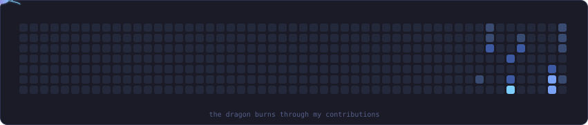

<h1 align="center">Hi, I'm Adhyyan Verma ✦</h1>
<h3 align="center">Frontend & UI Enthusiast | Building Clean, Modern Web Experiences</h3>

  

  

---

## 🚀 About Me
- 🔭 I’m currently building responsive, user-friendly websites and web applications.
- 🌱 I’m strengthening my skills in **HTML, CSS, JavaScript, React, and modern web development**.
- 💡 I enjoy turning ideas into clean, accessible, and visually appealing interfaces.
- 🎯 My goal is to create products that are fast, intuitive, and delightful to use.
- 📍 Based in **India**.
- 📫 Reach me through GitHub or the links below.

---

## 🛠️ Tech Stack

### Frontend

  

### Tools & Workflow

  

---

## 📊 GitHub Stats

  
   
  

---

## 🐉 Contribution Graph

  <picture>
    <source media="(prefers-color-scheme: dark)" srcset="https://raw.githubusercontent.com/adhyyanverma9080-max/adhyyanverma9080-max/output/github-dragon-dark.svg?v=2" />
    <source media="(prefers-color-scheme: light)" srcset="https://raw.githubusercontent.com/adhyyanverma9080-max/adhyyanverma9080-max/output/github-dragon.svg?v=2" />
    
  </picture>

---

## 🌐 Connect With Me

  
  
  

---

<h3 align="center">✨ "Good design is invisible. Great code is reliable." ✨</h3>
